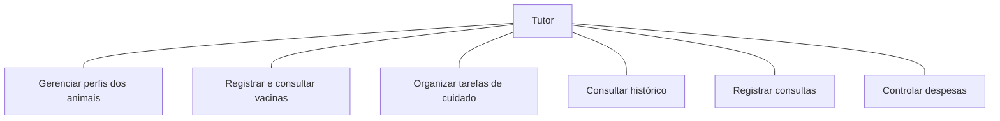

# CindyCare — Casos de uso

## Ator

Tutor: pessoa que cadastra animais e organiza seus cuidados.

O protótipo não possui autenticação.
O ator representa quem está utilizando o navegador.

## Visão geral

O diagrama abaixo representa as funcionalidades disponíveis ao tutor.
É uma visão de interações em Mermaid, não um diagrama UML formal.

## UC01 — Cadastrar animal

Requisito: RF01.
Regras: RN01 e RN02.

### Fluxo principal

1. O tutor escolhe Adicionar animal.
2. O sistema exibe o formulário.
3. O tutor informa nome e espécie.
4. Opcionalmente, informa raça, nascimento e peso.
5. O tutor confirma o cadastro.
6. O sistema valida e salva o animal.
7. O animal passa a estar disponível para seleção.

### Fluxos alternativos

- Nome ou espécie ausente: indicar o campo obrigatório.
- Nascimento futuro: impedir o cadastro e explicar o erro.
- Peso inválido: solicitar um número maior que zero.
- Cancelamento: fechar o formulário sem cadastrar.

## UC02 — Editar perfil

Requisito: RF02.
Regras: RN01 e RN02.

### Precondição

Existe um animal cadastrado.

### Fluxo principal

1. O tutor seleciona um animal.
2. Abre a edição do perfil.
3. Altera os dados desejados.
4. Confirma a alteração.
5. O sistema valida e salva o perfil atualizado.

### Fluxo alternativo

Dados inválidos impedem o salvamento e mantêm o formulário aberto.

## UC03 — Registrar vacina

Requisito: RF03.
Regras: RN03 e RN04.

### Precondição

Existe um animal selecionado.

### Fluxo principal

1. O tutor abre a área de vacinas.
2. Escolhe Adicionar vacina.
3. Informa nome e data da aplicação.
4. Opcionalmente, informa próxima dose e observações.
5. Confirma o registro.
6. O sistema valida e adiciona a vacina ao histórico do animal.

### Fluxos alternativos

- Aplicação futura: impedir o salvamento.
- Próxima dose igual ou anterior à aplicação: impedir o salvamento.
- Próxima dose vazia: permitir o registro.

## UC04 — Cadastrar tarefa

Requisito: RF04.
Regras: RN03, RN05 e RN07.

### Fluxo principal

1. O tutor abre a área de cuidados.
2. Escolhe Nova tarefa.
3. Informa título, categoria e data prevista.
4. Opcionalmente, informa recorrência em dias.
5. Confirma o cadastro.
6. O sistema cria uma tarefa pendente para o animal selecionado.

### Fluxo alternativo

Recorrência preenchida com zero, número negativo ou fracionário
impede o salvamento.

## UC05 — Concluir tarefa

Requisito: RF05.
Regras: RN06 e RN07.

### Precondição

A tarefa está pendente.

### Fluxo principal

1. O tutor escolhe Concluir.
2. O sistema solicita a data de realização.
3. O tutor informa a data e confirma.
4. O sistema valida a data.
5. A tarefa passa para concluída.
6. Se houver recorrência, o sistema cria a próxima tarefa pendente.

### Fluxos alternativos

- Data futura: impedir a conclusão.
- Cancelamento: manter a tarefa pendente.
- Tarefa já concluída: não permitir uma segunda conclusão.

## UC06 — Consultar pendências e histórico

Requisitos: RF06, RF10 e RF11.
Regras: RN03, RN05, RN13 e RN14.

### Fluxo principal

1. O tutor seleciona um animal.
2. O painel exibe suas tarefas pendentes em ordem de data.
3. Tarefas anteriores ao dia atual aparecem como atrasadas.
4. O tutor abre o histórico.
5. O sistema exibe vacinas, cuidados concluídos e consultas do animal.

### Fluxo alternativo

Quando não há registros, o sistema apresenta uma mensagem
explicando que a lista está vazia.

## UC07 — Registrar consulta

Requisito: RF07.
Regras: RN03 e RN09.

### Fluxo principal

1. O tutor abre Consultas.
2. Escolhe Adicionar consulta.
3. Informa data e motivo.
4. Opcionalmente, adiciona observações.
5. Confirma o registro.
6. O sistema valida e salva a consulta.

### Fluxo alternativo

Data futura impede o salvamento.

## UC08 — Registrar e consultar despesas

Requisitos: RF08 e RF09.
Regras: RN03, RN10 e RN11.

### Fluxo principal

1. O tutor abre Despesas.
2. Escolhe Adicionar despesa.
3. Informa descrição, categoria, data e valor.
4. Confirma o registro.
5. O sistema valida e salva a despesa.
6. O tutor seleciona os filtros desejados.
7. O sistema atualiza a lista e o total.

### Fluxos alternativos

- Valor inválido ou data futura: impedir o salvamento.
- Período com datas invertidas: solicitar correção.
- Nenhum registro encontrado: exibir total de R$ 0,00.

## UC09 — Editar ou excluir registros

Requisito: RF12.
Regra: RN12.

### Fluxo principal de edição

1. O tutor escolhe uma vacina, consulta ou despesa.
2. Abre a edição e altera os campos.
3. Confirma.
4. O sistema aplica as validações do tipo de registro.
5. Salva as alterações e atualiza a interface.

### Fluxo principal de exclusão

1. O tutor escolhe Excluir em um registro.
2. O sistema solicita confirmação.
3. O tutor confirma.
4. O sistema remove o registro e atualiza a interface.

### Fluxo alternativo

Cancelar a confirmação mantém o registro.

## UC10 — Editar ou cancelar tarefa

Requisito: RF13.
Regra: RN08.

### Precondição

A tarefa está pendente.

### Fluxo principal

1. O tutor seleciona uma tarefa.
2. Escolhe editar seus dados ou cancelar a tarefa.
3. Confirma a operação.
4. O sistema valida e atualiza o registro.

### Fluxos alternativos

- Tarefa concluída ou cancelada: impedir edição e nova mudança de estado.
- Cancelamento de tarefa recorrente: não gerar outra ocorrência.

## Exceção comum — Falha ao salvar

Regra: RN15.

Se o armazenamento falhar, o sistema deve informar o problema
e não apresentar a operação como salva com sucesso.